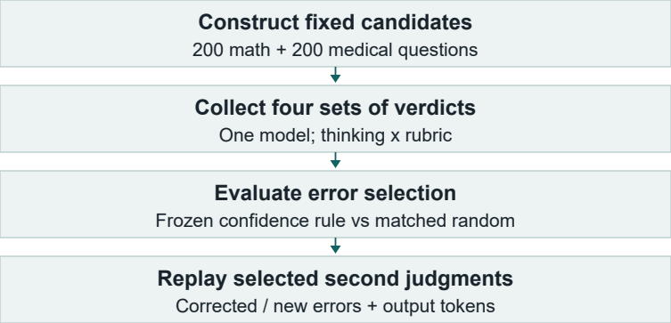
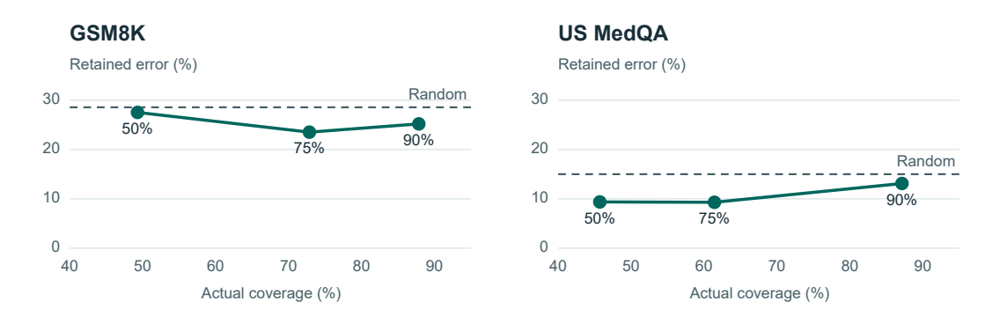
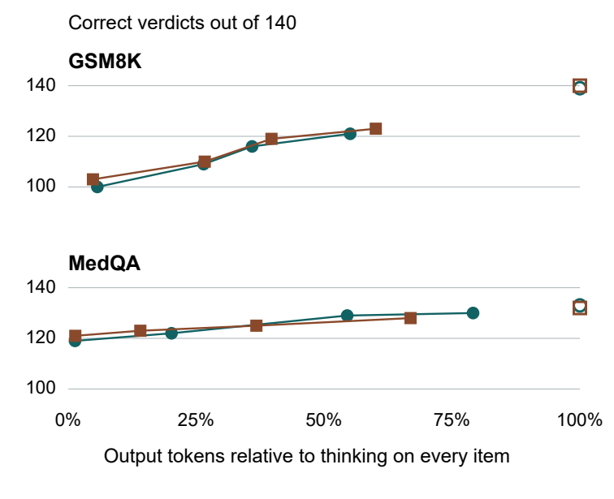

# Can a language-model judge identify its own grading errors?
DSC 261 · Responsible Data Science · Final report

Haoxiang Qiu, Yuguo Du, Edith Gu, Lucia Si, Wenkai Kang

## Abstract
An automated grader must judge an answer and communicate whether its own verdict should be trusted. We study these tasks on 400 math and medical exam questions using one locally hosted model served as qwen3.8-27b. A separate prompt permitting abstention deferred none of 280 test judgments. At a 75% retention target, plain-prompt confidence referred 13 of 21 medical grading errors in 54 cases, versus 8.1 errors expected at random. On math, most apparent gains disappeared after averaging over identical confidence scores. Thinking improved verdicts but increased output and sometimes yielded no usable answer. Replaying saved thinking-enabled verdicts on the 54 medical referrals corrected 12 errors and introduced two: 129 final judgments were correct, versus a random mean of 125.2 and central 95% range of 121-129. This policy used 37% more output tokens than same-count random review. The results show a limited medical prioritization signal, not a general advantage of confidence-guided review.

## 1 Introduction
An automated grader may reject a correct answer with complete confidence. Reviewing everything sacrifices efficiency; reviewing arbitrary cases may miss errors that a useful score could locate. We ask whether the judge's least confident verdicts identify more mistakes than random selection under the same review workload.

Four questions organize the study: will the judge voluntarily abstain; can its confidence prioritize errors; does switching selected cases to thinking-enabled judgments improve final decisions; and how much output does this require? Rubric and thinking ablations separate stronger grading from better error ranking. A model that rarely errs can be a strong grader while leaving little evidence about its ability to recognize mistakes.

Figure 1. The four-stage study. The final stage reuses independent saved judgments; no model receives its earlier verdict or the official key.

## 2 Related work
Selective classification [1] evaluates error together with retained coverage. We apply it to the correctness of a grading verdict. Research on stated probabilities [2] motivates confidence elicitation, while LLM-as-a-judge work [3] studies automated evaluation reliability. Our outcome is agreement with an official answer key, rather than subjective preference agreement. The key also lets us count referred errors without assuming that a human reviewer would correct them.

## 3 Study design
**Cohort and labels.** We sampled 200 questions from each official test pool. Each question has one fixed candidate, shared across all prompts. In each domain, 60 questions calibrate the retention rule and 140 evaluate it. Each split contains equal numbers of correct and incorrect candidates. The judge receives the question, candidate and original options where applicable; only the evaluator has the official key. If the candidate is wrong and the judge rejects it, the judge earns a correct verdict.

| Domain | Correct candidate | Incorrect candidate |
| --- | --- | --- |
| GSM8K · math [4] | Official numeric answer | Seeded arithmetic change, same sign and integer format |
| US MedQA · exam questions [5] | Official answer option | An existing distractor from the same question |

GSM8K wrong answers use a seeded choice among plus one, minus one, double and half, retaining only distinct integers of the same sign. MedQA uses the original US English five-option format. Before sampling we remove unusable formats, missing-image references and conflicting duplicates; the selection seed is 2612026. These controlled errors do not represent every error made by students or generated answers.

Development runs found 41 math and 13 medical grading errors per 100 candidates, enough to study error selection. A limited harder medical trial encountered repeated truncation. We kept the original datasets and excluded development items by source ID and normalized question hash. This prevents reuse of our pilot questions but cannot rule out training exposure. No judge generated candidates.

**Unit of analysis.** Each test domain has 70 correct and 70 incorrect candidates. Four verdicts on the same question are repeated observations, not four independent questions. Reported confidence concerns the judge's own verdict: rejecting a wrong candidate is a correct judgment.

**Model and generation settings.** All reported experiments used one locally hosted model served under the identifier qwen3.8-27b, verified against the archived formal configuration and interface audit. The service identifier does not independently establish an upstream checkpoint revision. Formal calls used temperature 0, max_tokens 8192, concurrency one and no retries. The endpoint's enable_thinking setting controlled reasoning mode. We did not train or fine-tune a model. The release records these settings and the mapping from the normalized analysis alias local-llm to the served identifier.

| Condition | Thinking | Rubric |
| --- | --- | --- |
| C1: plain | Off | No |
| C2: rubric | Off | Yes |
| C3: thinking | On | No |
| C4: both | On | Yes |

The rubric asks the judge to solve independently, check units and constraints, then compare its answer with the candidate. Every call returns a binary verdict and confidence in that verdict. Across four conditions and 400 candidates, 1,586 of 1,600 calls were valid. Fourteen medical thinking-enabled calls reached the output limit: eight calibration and six test calls. They are incomplete outputs, not deliberate abstentions. Exact prompts accompany the release.

## 4 Direct abstention
With thinking off, a separate plain prompt allowed Correct, Incorrect or Abstain. The model graded all 280 test cases, making 41 math and 22 medical errors: 48 false acceptances and 15 false rejections. None was referred for review. This result describes one prompt and sample, not an inability ever to abstain. Matching other policies to zero referrals would select no useful subsets, so the following analysis uses the separate binary-verdict confidence runs.

## 5 Confidence under a fixed review budget
For each domain and prompt, we used the calibration scores to set a cutoff for each target (50%, 75%, 90%) and fixed the rule for ties. Ties use a stable seeded hash of case ID, independent of correctness labels. Calibration here chooses a selection policy; it does not fit a transformation that makes stated probabilities more accurate. Applying that rule to new cases produces a realized count, k. Coverage is k divided by 140 planned cases. Retained error rate is the number of incorrect retained verdicts divided by k. The random comparison draws exactly k from the same valid pool. Its expected error rate equals the pool's error rate because each verdict has the same chance of being drawn.

These percentages are calibration targets, not probability thresholds or enforced test quotas. The medical 75% policy neither accepts scores above 0.75 nor reselects the top 105 test items. It applies a rule fixed on separate questions; random selection therefore matches the actual retained count.

Figure 2. Plain prompt, thinking off. Points show frozen confidence rules and labels show their calibration targets. Dashed lines give the exact matched random expectation. A lower point at the same horizontal position means fewer errors for the same number of reviews.

Table 1. Counts behind Figure 2. Each group began with 140 test cases. Before selection, the plain judge made 40 math errors (28.57%) and 21 medical errors (15.00%).

| Target | GSM8K retained | Errors / retained | MedQA retained | Errors / retained |
| --- | --- | --- | --- | --- |
| 50% | 69/140 | 19/69 · 27.54% | 64/140 | 6/64 · 9.38% |
| 75% | 102/140 | 24/102 · 23.53% | 86/140 | 8/86 · 9.30% |
| 90% | 123/140 | 31/123 · 25.20% | 122/140 | 16/122 · 13.11% |

### What did 54 medical review slots buy?
At the 75% target, the policy retained 86/140 judgments (61.4%) with eight errors. Its 54 referrals contained 13 of the 21 original errors, versus 8.1 expected at random. At 90%, only 18 cases were flagged and retained error rose to 13.11%. These are errors located, not measured human corrections.

At 75%, retained error was 9.30% versus random 15.00%, a -5.70 percentage-point difference (95% paired bootstrap interval -11.10 to -1.02). The 1,000 resamples pair questions across conditions within candidate-label strata, holding the calibrated rule fixed. They exclude uncertainty from fitting a new rule. The next check instead varies equal-score boundary choices.

### How much of the gain survives tied scores?
On GSM8K, 136/140 plain-prompt judgments received maximum confidence. At the 75% target, 102 of those 136 tied cases were retained. The fixed rule happened to keep 24 errors, but the tied group contained 38. Uniformly choosing 102 within the tie would keep 102 × 38/136 = 28.5 errors on average. The resulting 27.94% risk is close to the 28.57% random baseline. The apparent five-point gain in Figure 2 thus depends largely on which equal-score cases were kept. On MedQA, averaging over cutoff ties yields 10.96%, still below its 15.00% random baseline.

The frozen result evaluates one deployed rule. The tie average keeps higher-scored cases and averages over equal-score boundary choices at the same count, isolating information in the scores. For rubric-only math, fixed error 20.79% becomes 26.81%, versus random 26.43%. For rubric-only medicine, the tie average remains 11.04% versus random 13.57%. A rubric does not remove this contrast.

## 6 Rubric and thinking ablations
Table 2. Results at the 75% calibration target. Fractions give errors / judgments. The random expectation in each row equals the error rate of all valid judgments. Parenthesized rates show the observed error among retained judgments.

| Prompt | GSM8K all valid | GSM8K retained | MedQA all valid | MedQA retained |
| --- | --- | --- | --- | --- |
| Plain | 40/140 | 24/102 (23.53%) | 21/140 | 8/86 (9.30%) |
| Rubric | 37/140 | 21/101 (20.79%) | 19/140 | 12/105 (11.43%) |
| Thinking | 1/140 | 1/92 (1.09%) | 5/138 | 0/107 (0.00%) |
| Thinking + rubric | 0/140 | 0/90 (0.00%) | 4/136 | 0/113 (0.00%) |

Enabling thinking coincided with the largest drop in overall error. On math, one or zero errors remained to be found. On medicine, both thinking settings placed all observed valid errors below the cutoff. Zero retained errors still permits positive underlying risk: the 95% Wilson upper limits are 3.47% for 0/107 and 3.29% for 0/113. With the rubric alone, both domains had slightly fewer total mistakes than under the plain prompt; the confidence rule also retained different numbers. Comparisons to random are matched within each row.

The denominator matters when interpreting a stronger configuration. Counting every attempted test item, thinking alone on MedQA produced 133 correct verdicts, five wrong ones and two truncations. Adding a rubric produced 132 correct verdicts, four wrong ones and four truncations. The latter has slightly better accuracy among valid answers but did not deliver more correct decisions in the same 140 slots. Conversely, zero math errors with both options leaves no errors for any review policy to identify; that ceiling says little about error ranking.

### Confidence quality and the cost of thinking

Brier score averages (confidence minus outcome) squared, where outcome is 1 for a correct verdict and 0 otherwise. Lower is better. A confidence of 0.95 incurs 0.0025 loss if correct and 0.9025 if wrong. This measures probability quality, not error ranking alone; simply making fewer errors can improve it.

| Domain / prompt | Correct / valid | Brier | Output tokens | Time (s) |
| --- | --- | --- | --- | --- |
| GSM8K / plain | 100/140 | 0.284 | 16.7 | 0.25 |
| GSM8K / rubric | 103/140 | 0.264 | 17.7 | 0.25 |
| GSM8K / thinking | 139/140 | 0.008 | 294.1 | 0.91 |
| GSM8K / both | 140/140 | 0.002 | 365.6 | 0.96 |
| MEDQA / plain | 119/140 | 0.141 | 16.7 | 0.25 |
| MEDQA / rubric | 121/140 | 0.129 | 16.5 | 0.25 |
| MEDQA / thinking | 133/138 | 0.030 | 1255.1 | 2.78 |
| MEDQA / both | 132/136 | 0.023 | 1191.0 | 2.83 |

Output is mean API-reported completion tokens per attempted call; time is the median client-observed latency on this service. Each row covers 140 attempts. Valid accuracy and Brier exclude incomplete calls; resources include them. Medical thinking increased mean output from 17 to 1,255 tokens and median latency from 0.25 to 2.78 seconds. These times are not hardware-independent speed comparisons.

## 7 Which judgments benefit from a second pass?
We reconstructed a two-stage workflow offline from existing records on the same 140 test cases per domain. This is paired replay, not a new inference run or a self-correction prompt. The first pass issues a verdict with thinking disabled. A case excluded by its frozen retention rule receives the independent thinking-enabled verdict on that same candidate. Both calls use the same rubric setting (C1 to C3 without a rubric, C2 to C4 with one). When the second output is incomplete, the workflow keeps the usable first verdict and charges the second call's tokens. Each case therefore has one final decision. No model saw its earlier judgment. The second verdict was generated independently with the same question and candidate; the workflow merely selects which saved verdict becomes final.

**Random assignment.** For a policy that switches k cases, every k-subset of the 140 is equally likely in the comparison. Each item contributes +1 if switching corrects a mistake, -1 if it introduces one, or 0 otherwise. We count subsets with each possible number of gains and losses to obtain the exact distribution of final correct counts. The mean and the 2.5th and 97.5th percentiles describe assignment variability on these fixed items. The twelve comparisons reuse cases and are descriptive. They do not quantify variation across new cohorts or model runs.

Table 3. Correct verdicts out of 140 after switching. The first column identifies the prompt pair and its target retention percentage. Random uses exactly the number switched in the second column. Brackets give its central 95% range.

| Pair / target | Switched | Correct | Random mean | 95% range |
| --- | --- | --- | --- | --- |
| Math 1/3 · 50% | 71 | 121 | 119.8 | 114–125 |
| Math 1/3 · 75% | 38 | 116 | 110.6 | 106–115 |
| Math 1/3 · 90% | 17 | 109 | 104.7 | 101–108 |
| Math 2/4 · 50% | 71 | 123 | 121.8 | 117–127 |
| Math 2/4 · 75% | 39 | 119 | 113.3 | 109–118 |
| Math 2/4 · 90% | 14 | 110 | 106.7 | 104–110 |
| Med. 1/3 · 50% | 76 | 130 | 127.7 | 123–132 |
| Med. 1/3 · 75% | 54 | 129 | 125.2 | 121–129 |
| Med. 1/3 · 90% | 18 | 122 | 121.1 | 118–124 |
| Med. 2/4 · 50% | 58 | 128 | 126.4 | 123–130 |
| Med. 2/4 · 75% | 35 | 125 | 124.2 | 121–128 |
| Med. 2/4 · 90% | 13 | 123 | 122.2 | 120–125 |

On the medical plain prompt at the 75% target, switching 54 cases corrected 12 decisions and introduced two errors. One incomplete second call kept its original verdict. The total rose from 119 to 129. Randomly switching 54 averaged 125.2 correct, with 129 at the upper endpoint. With the rubric at the same target, switching 35 cases corrected five and introduced one, raising 121 to 125 against a random mean of 124.2. Across all six medical comparisons, confidence exceeded the random mean but stayed within its central range.

On math, three observed totals exceeded the upper random endpoint by one verdict. The scores were heavily tied. Table 4 shows how the 75% results change when we average over equal-score choices at the same workload. The medical signal remains modest; the math advantage largely vanishes.

Table 4. Final correct counts under alternative cutoff-tie selections at the 75% target. Same-count random means use the same 140 cases.

| Pair | Fixed rule | Tie average | Random |
| --- | --- | --- | --- |
| Math C1/C3 | 116 | 111.25 | 110.59 |
| Math C2/C4 | 119 | 112.92 | 113.31 |
| Med. C1/C3 | 129 | 127.49 | 125.17 |
| Med. C2/C4 | 125 | 125.71 | 124.25 |

Figure 3. Each curve starts with thinking disabled and adds second calls at three workloads. Circles denote plain prompts and squares denote rubrics. Open markers give correct verdicts from standalone thinking across all 140 attempts, including missing outputs in the denominator. Token counts include both stages of the replay.

### Output tokens per grading method
Table 5. Plain prompt at 75% target retention. Each cell gives correct verdicts out of 140 and total output tokens. The random row gives same-count expectations rounded to one verdict decimal and the nearest token.

| Method | Math: correct / tokens | Medicine: correct / tokens |
| --- | --- | --- |
| First pass only | 100 / 2,342 | 119 / 2,334 |
| Confidence review | 116 / 14,799 | 129 / 95,815 |
| Random review | 110.6 / 13,519 | 125.2 / 70,111 |
| Thinking throughout | 139 / 41,177 | 133 / 175,719 |

The two-stage totals include the first verdict on all 140 cases and every selected second call, including truncated outputs. On medicine, selecting 54 cases by confidence yielded 3.8 more correct verdicts than random review on average and used 25,704 more output tokens (37%). Thinking throughout yielded another four correct verdicts and two incomplete outputs. On math, selecting 38 cases used 1,280 more tokens than random review on average. Much of the observed accuracy advantage depended on which equally confident cases were selected.

Confidence review used 32-56% more output tokens than same-count random review across the six medical policies; math ranged from 2% fewer to 80% more. The companion CSV also covers standalone and voluntary-abstention runs. Totals include both replay stages and incomplete attempts, but exclude input tokens. They are measured after policy reconstruction, not under a preset token budget, and do not measure full monetary, energy or compute costs.

## 8 What the individual cases show

We selected the smallest blinded ID in each of three plain-prompt groups per domain: maximum-confidence errors, flagged errors and flagged correct judgments at the 75% target. On a 100-vote math question, the correct remainder was 50; the judge rejected 50 with maximum confidence. A sound verdict on a jury-pay question was also flagged. On MedQA, a fully confident acceptance of a distractor stayed automated, while a rejection of the keyed immune-signaling answer was flagged at 0.95.

All 54 medical referrals had confidence 0.95: 13 were errors and 41 were sound judgments. Eight errors remained among the 86 retained cases. Confidence therefore identified a group with more errors, not a reliable diagnosis of each item. The six examples are reproducibly selected illustrations, not a representative survey or evidence of human review quality.

## 9 Findings, limits and reproducibility

**Findings.** Medical confidence concentrated some grading errors into a fixed-size queue. Thinking substantially improved judgments. Selective medical replay exceeded the random mean in all six comparisons, but remained inside the central random ranges and used 32-56% more output tokens. Math confidence had little ordering resolution; fixed tie choices accounted for much of its apparent benefit. Better grading and better error prioritization are distinct achievements.

**Limits.** Evidence covers one served model, balanced constructed candidates and official answer keys. The domains differ in format and error construction, so their contrast is not a pure domain effect. Training exposure is unknown. Zero voluntary abstentions apply to one prompt and sample. The bootstrap intervals hold the calibration rule fixed; random ranges describe assignments of these existing cases, not new cohorts or repeated model runs. We measured neither human corrections nor clinical outcomes. Replication on fresh cases and another verified model, with policies fixed beforehand, would test generality.

**Reproducibility.** The public repository provides prompts, model provenance, locked inclusion flags, saved verdicts, 24 coverage comparisons, 12 paired replays and resource fields from 1,120 scheduled test calls. Offline replay reconstructs tables and reports without model access. The instructor ZIP adds source questions, constructed candidates and recorded final response text so the cohort and joins can be checked. Regenerating model outputs is a separate step requiring access to the original served system; even temperature 0 does not establish that new calls will be identical. Codex assisted with implementation, analysis, record checks and drafting.

## References

[1] Yonatan Geifman and Ran El-Yaniv. 2017. Selective Classification for Deep Neural Networks. NeurIPS 30. https://arxiv.org/abs/1705.08500

[2] Saurav Kadavath et al. 2022. Language Models (Mostly) Know What They Know. arXiv:2207.05221. https://arxiv.org/abs/2207.05221

[3] Lianmin Zheng et al. 2023. Judging LLM-as-a-Judge with MT-Bench and Chatbot Arena. NeurIPS Datasets and Benchmarks. https://arxiv.org/abs/2306.05685

[4] Karl Cobbe et al. 2021. Training Verifiers to Solve Math Word Problems. arXiv:2110.14168. https://arxiv.org/abs/2110.14168

[5] Di Jin, Eileen Pan, Nassim Oufattole, Wei-Hung Weng, Hanyi Fang and Peter Szolovits. 2021. What Disease Does This Patient Have? A Large-Scale Open Domain Question Answering Dataset from Medical Exams. Applied Sciences 11(14), 6421. doi:10.3390/app11146421. https://doi.org/10.3390/app11146421
