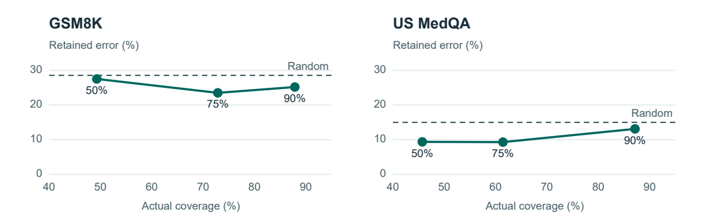

# Can a language-model judge identify its own grading errors?
DSC 261 · Responsible Data Science · Midterm update v0.2, revised

Haoxiang Qiu, Yuguo Du, Edith Gu, Lucia Si, Wenkai Kang

## Motivation and research question
A grader can solve many problems correctly and still approve a wrong answer with complete confidence. For someone using that grader, two decisions matter: which candidate answers to accept, and which grading decisions deserve a second look. We study the second decision using selective prediction [1], self-reported confidence [2], and factual correctness as an LLM judging task [3]. At a given review workload, does setting aside the judge's least confident verdicts catch more of its mistakes than setting aside cases at random?

## From a benchmark question to a grading decision
We sampled 200 questions from each official test pool. Each question has one fixed candidate, shared across all prompts. In each domain, 60 questions calibrate the retention rule and 140 evaluate it. Each split contains equal numbers of correct and incorrect candidates. The judge receives the question, candidate and original options where applicable; only the evaluator has the official key. If the candidate is wrong and the judge rejects it, the judge earns a correct verdict.

| Domain | Correct candidate | Incorrect candidate |
| --- | --- | --- |
| GSM8K · math [4] | Official numeric answer | Deterministic change to the official number |
| US MedQA · exam questions [5] | Official answer option | An existing distractor from the same question |

We queried a local large language model for a binary verdict and confidence in that verdict. We crossed two prompt choices: providing a grading rubric and enabling the endpoint's thinking setting. Across four conditions and 400 candidates, 1,586 of 1,600 calls produced valid judgments. The 14 truncated responses occurred on medical questions with thinking enabled. We count these separately from a deliberate decision to defer.

## What happened when the judge could decline?
A separate plain, thinking-off prompt, informed by the team pipeline design [6], explicitly allowed abstention. The local model graded all 280 evaluation cases. It made 41 math errors and 22 medical errors. Of those 63 mistakes, 48 accepted a wrong candidate and 15 rejected a correct one. Giving the judge discretion referred none of them for review. This establishes its behavior on this prompt and sample. With all cases retained, there is no selected subset on which to evaluate its ability to pick cases. The following comparison uses the confidence scores from the binary-verdict runs.

---

## Confidence under three review workloads
For each domain and prompt, we used the calibration scores to set a cutoff for each target (50%, 75%, 90%) and fixed the rule for ties. Applying that rule to new cases produces a realized count, k. Coverage is k divided by 140 planned cases. Retained error is the number of incorrect verdicts among the k retained. The random comparison draws exactly k from the same valid pool. Its expected error rate equals the pool's error rate because each verdict has the same chance of being drawn.

Figure 1. Plain prompt, thinking off. Points show frozen confidence rules and labels show their calibration targets. Dashed lines give the exact matched random expectation. A lower point at the same horizontal position means fewer errors for the same number of reviews.

Table 1. Counts behind Figure 1. Each group began with 140 test cases. Before selection, the plain judge made 40 math errors (28.57%) and 21 medical errors (15.00%).

| Target | GSM8K retained | Errors / retained | MedQA retained | Errors / retained |
| --- | --- | --- | --- | --- |
| 50% | 69/140 | 19/69 · 27.54% | 64/140 | 6/64 · 9.38% |
| 75% | 102/140 | 24/102 · 23.53% | 86/140 | 8/86 · 9.30% |
| 90% | 123/140 | 31/123 · 25.20% | 122/140 | 16/122 · 13.11% |

## What did the 54 MedQA review slots buy?
At the 75% target, the rule actually retained 86/140 judgments (61.4%). Of the 21 original errors, 8 remained and 13 fell in the 54 flagged cases. Randomly flagging 54 would capture 8.1 errors on average. Confidence therefore located about five additional errors at the same workload. Moving from the 50% to the 75% target retained 22 more decisions with almost the same error rate. At the 90% target only 18 were flagged, and retained error rose to 13.11%. The fixed-rule medical error gap at the 75% target was -5.70 percentage points (paired bootstrap 95% interval, -11.10 to -1.02 points). This interval holds the calibrated policy fixed; changing the selected cases at the cutoff is examined on the next page. These counts evaluate routing against the official key; we did not measure a human reviewer's subsequent decisions.

---

## When many judgments receive the same score
On GSM8K, 136/140 plain-prompt judgments received maximum confidence. At the 75% target, 102 of those 136 tied cases were retained. The fixed rule happened to keep 24 errors, but the tied group contained 38. Uniformly choosing 102 within the tie would keep 102 × 38/136 = 28.5 errors on average. The resulting 27.94% risk is close to the 28.57% random baseline. The apparent five-point gain in Figure 1 thus depends largely on which equal-score cases were kept. On MedQA, averaging over cutoff ties yields 10.96%, still below its 15.00% random baseline.

## How rubric and thinking affected grading
Table 2. Results at the 75% calibration target. Fractions give errors / judgments. The random expectation in each row equals the error rate of all valid judgments. Parenthesized rates show the observed error among retained judgments.

| Prompt | GSM8K all valid | GSM8K retained | MedQA all valid | MedQA retained |
| --- | --- | --- | --- | --- |
| Plain | 40/140 | 24/102 (23.53%) | 21/140 | 8/86 (9.30%) |
| Rubric | 37/140 | 21/101 (20.79%) | 19/140 | 12/105 (11.43%) |
| Thinking | 1/140 | 1/92 (1.09%) | 5/138 | 0/107 (0.00%) |
| Thinking + rubric | 0/140 | 0/90 (0.00%) | 4/136 | 0/113 (0.00%) |

Enabling thinking coincided with the largest drop in overall error. On math, one or zero errors remained to be found. On medicine, both thinking settings placed all observed valid errors below the cutoff. Zero retained errors still permits positive underlying risk: the 95% Wilson upper limits are 3.47% for 0/107 and 3.29% for 0/113. With the rubric alone, both domains had slightly fewer total mistakes than under the plain prompt; the confidence rule also retained different numbers. Comparisons to random are matched within each row.

## Limits, progress and next test
The two benchmarks differ in answer format, candidate construction and difficulty. A contrast between them cannot establish a domain effect. Correct and incorrect candidates are artificially balanced, benchmark exposure is unknown, and official medical exam keys do not establish clinical performance. The saved runs cover one judge and the optional-abstention prompt reused the same evaluation items.

At midpoint the dataset, four prompt conditions, optional-abstention run and all 24 coverage comparisons are complete. For the final study we propose checking whether the medical advantage and the math score ties recur on fresh questions with the rules frozen. A second judge on the same candidates is an optional cross-model check. Code, de-identified verdicts and build instructions accompany this report. Codex assisted with implementation, experiment execution, analysis and drafting.

---

## References

[1] Yonatan Geifman and Ran El-Yaniv. 2017. Selective Classification for Deep Neural Networks. NeurIPS 30. https://arxiv.org/abs/1705.08500

[2] Saurav Kadavath et al. 2022. Language Models (Mostly) Know What They Know. arXiv:2207.05221. https://arxiv.org/abs/2207.05221

[3] Lianmin Zheng et al. 2023. Judging LLM-as-a-Judge with MT-Bench and Chatbot Arena. NeurIPS Datasets and Benchmarks. https://arxiv.org/abs/2306.05685

[4] Karl Cobbe et al. 2021. Training Verifiers to Solve Math Word Problems. arXiv:2110.14168. https://arxiv.org/abs/2110.14168

[5] Di Jin, Eileen Pan, Nassim Oufattole, Wei-Hung Weng, Hanyi Fang and Peter Szolovits. 2021. What Disease Does This Patient Have? A Large-Scale Open Domain Question Answering Dataset from Medical Exams. Applied Sciences 11(14), 6421. doi:10.3390/app11146421. https://doi.org/10.3390/app11146421

[6] EdithGu. DSC261 judging pipeline skeleton, project collaboration, commit c9f40de. https://github.com/EdithGu/dsc261-llm-judge/tree/c9f40de92fa61309b0cd733dabcfafd9fa5363f2
